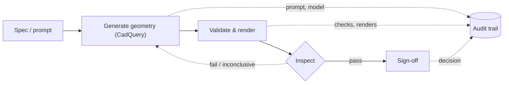

<!-- Hero (badge, subtitle, buttons) is rendered by layouts/index.html over the wireframe
     background; its copy lives in data/hero.yaml. The body below renders normally. -->

## How it works

Every step is captured — the prompt, the model, each validation result, and the final sign-off. That audit trail is not a feature; **it's the product.**

And inspection is tri-state: every check returns *pass*, *fail* — or *inconclusive*. When the validator can't decide, we say so instead of guessing. Honest measurement is what makes a benchmark a benchmark — [why we score inconclusive](/blog/2026-10-17-tri-state/).

## Why now

Two forces are converging on engineering teams:

- **Cost pressure.** Design cycle time is a cost center. AI that drafts the first 80% of a part changes the math — *if* you can trust what it produces. The open question was never "can a model generate geometry?" but "who verifies it, and can you prove it?"
- **Compliance.** The EU AI Act's transparency duties have applied since August 2026, and the high-risk obligations land in December 2027 and August 2028. Teams that can *show* their AI design process is controlled, logged and auditable will have an edge — the boring documentation work is now a differentiator. [The compliance window, explained](/blog/2026-10-17-compliance-window/).

Two ways in


  
  



