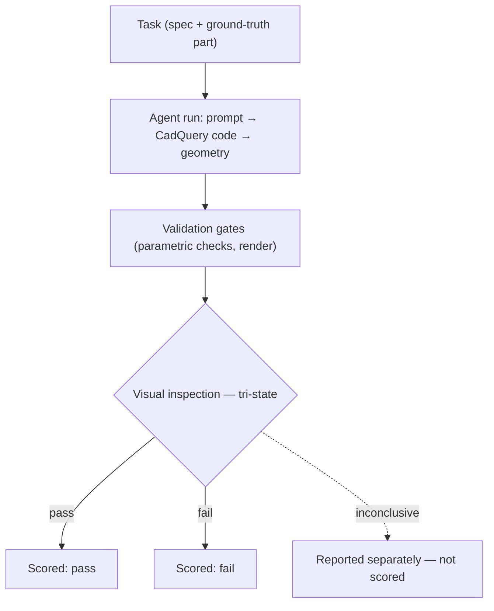

The benchmark is the heart of Story B. It turns "can an LLM do engineering?" from a demo into a measurement.

## The evaluation loop

Each task is a real design problem with a ground-truth part and explicit validation criteria. An agent run goes through the same loop it will use in production: generate, validate, inspect — and every step lands in the audit trail.

## Tri-state, not binary

A demo shows you the 10% that worked. A binary benchmark inherits that bias: *pass/fail* conflates "the model failed" with "we couldn't tell." When a validator can't decide, that is information about the *measurement* — not a verdict on the model.

So every inspection returns one of three states: **pass**, **fail**, or **inconclusive**. Inconclusive outcomes are excluded from the capability score — but reported as their own metric, because a benchmark that hides its uncertainty is hiding something.

## The score

For a model $m$ on a task set $T$, where each task $t$ yields an outcome $o_t \in \{\text{pass},\ \text{fail},\ \text{inconclusive}\}$:

$$
S_m = \frac{1}{|T_{\text{dec}}|} \sum_{t \in T_{\text{dec}}} \mathbb{1}\big[o_t = \text{pass}\big],
\qquad
T_{\text{dec}} = \{\, t \in T : o_t \neq \text{inconclusive} \,\}
$$

and the inconclusive rate is reported alongside it:

$$
I_m = \frac{|\{\, t : o_t = \text{inconclusive} \,\}|}{|T|}
$$

Two numbers, not one: capability *and* how much of the task set we could actually judge. The harness itself is covered by a 1,105-test suite, so the measurement instrument is as reproducible as the measurements.

## What's coming (v0.1)

The first benchmark release will include:

- A set of **design tasks** with ground-truth parts and validation criteria.
- **Capability scores** per task, per model — so you can compare models and track progress.
- **Reproducible runs** — same task, same model, comparable results across time.

> Status: in development (Milestone M2). This page will be populated with the first published results — including negative ones.

## Why a benchmark matters

A demo shows one success. A benchmark measures capability across many tasks, models, and time — which is what research (and a serious procurement decision) actually needs.

We will publish the method alongside the first results, so anyone can reproduce or extend it.


